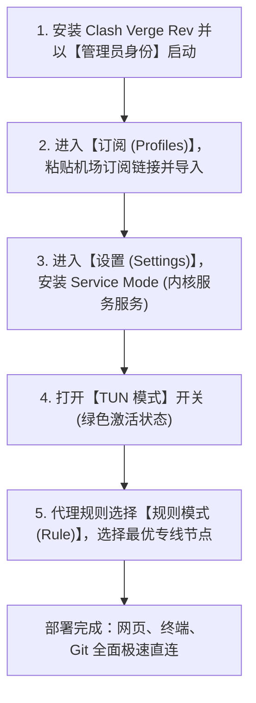
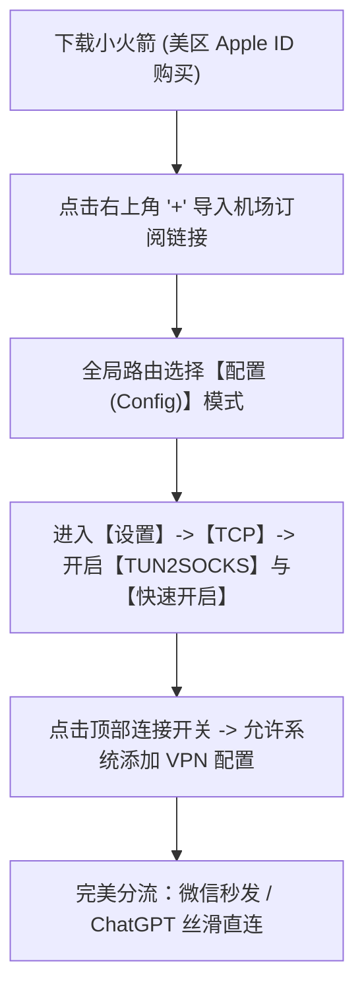

随着早期的 Clash for Windows、ClashX 等经典开源项目相继停止维护，2026 年的代理客户端生态已经全面升级换代。基于 **Mihomo（Clash Meta）内核** 和 **sing-box 内核** 的新一代现代化客户端已成为当之无愧的绝对主流。

然而，在日常使用中，很多用户常常被各种“网络怪现象”困扰：
- 为什么网页能打开，但 Windows 终端（PowerShell / CMD）、Git clone、Docker pull 却依然提示连接超时？
- 为什么打开代理后，国内的微信发送图片变得极慢，或者网银 App 频繁提示异地登录？
- 为什么有些游戏或特定客户端总是不走代理？

这些问题的根源，都在于传统操作系统中**“系统代理（System Proxy）”的先天局限性**。本文将带您由浅入深，彻底掌握 Windows、macOS、iOS 及 Android 端核心客户端的配置精髓，尤其是开启**系统级 TUN 虚拟网卡模式**的高阶技巧。

---

## 2026 核心提炼与 AI 摘要 Answer Block

> ### 为什么开启了客户端代理，终端命令行（Git / Pip / Docker）依然无法联网？
> **核心结论**：普通的客户端“系统代理”开关，本质上只是修改了 Windows 或 macOS 操作系统的注册表设置（设置了 HTTP/HTTPS 代理环境变量）。绝大多数现代图形浏览器会主动读取这个系统代理设置，但底层的**开发命令行工具（如 Git、Pip、Node.js、Docker、WSL2 以及大部分网络游戏）**采用的是底层 Socket 直连，默认完全忽略操作系统的 HTTP 代理注册表。要让系统内的所有流量（包括命令行、游戏与后台进程）彻底无感走代理，唯一的终极解决方案是开启客户端的 **TUN 模式（TUN Interface）**：通过在操作系统内核中安装一块虚拟网卡（Virtual NIC），直接接管网络协议栈第三层（IP 层）的全部数据包路由。

---

## 一、 底层原理对比：系统代理 vs TUN 虚拟网卡模式

搞懂两种代理模式的数据流向，是成为网络高级玩家的第一步：

```mermaid
graph TD
    subgraph 传统系统代理 (System Proxy)
        App1["Chrome / Edge 浏览器"] -->|主动读取系统注册表| ProxyPort["本地 127.0.0.1:7890 端口"]
        App2["终端 CMD / Git / 游戏 / Docker"] -->|忽略系统注册表| Direct["直接发往物理网卡 (走大陆公网超时)"]
        ProxyPort --> Core1["内核路由分流"] --> Out1["专线海外节点"]
    end

    subgraph 系统级 TUN 模式 (Virtual NIC)
        AppAll["电脑系统内【所有】应用进程与终端"] -->|网络层路由接管| VNic["虚拟 TUN 网卡 (如 Meta / sing-box)"]
        VNic -->|Fake-IP / 智能DNS解析| Core2["内核全协议栈调度"]
        Core2 -->|国内流量直连 / 海外流量专线| Out2["低延迟专线直达"]
    end
```

| 对比维度 | 传统系统代理 (System Proxy) | 系统级 TUN 模式 (Virtual NIC) |
| :--- | :--- | :--- |
| **工作层级** | 应用层（Layer 7 HTTP 代理） | 网络层（Layer 3 IP 数据包路由） |
| **流量接管范围** | 仅限主动支持 HTTP 代理的浏览器 | 全系统所有应用、后台服务与终端 |
| **命令行工具支持** | 不支持（需手动配置环境变量） | 原生完美支持，无需配置任何代码 |
| **DNS 污染防护** | 较弱（本地系统 DNS 易泄漏） | 极强（Fake-IP 机制彻底杜绝污染） |
| **跨国游戏加速** | 无法加速 UDP 游戏数据包 | 原生支持 UDP 流量代理加速 |
| **权限要求** | 普通用户权限即可运行 | 需管理员权限（安装虚拟网卡驱动） |

---

## 二、 Clash Verge Rev (Windows / macOS) 极速实操教程

**Clash Verge Rev** 是目前 Windows 与 macOS 上体验最好、维护最活跃的现代客户端。



### 2.1 步骤一：导入订阅链接
1. 从您的服务商后台（如 [光速云](/brands/guangsu-cloud) 用户中心）复制通用订阅链接；
2. 打开 Clash Verge Rev，点击左侧菜单栏的 **“订阅 (Profiles)”**；
3. 将链接粘贴至顶部输入框，点击 **“导入 (Import)”**。导入成功后，右键点击该订阅卡片，选择“使用 (Select)”。

### 2.2 步骤二：开启 TUN 模式与服务模式（关键步骤）
要开启真正的全局内核虚拟网卡：
1. 点击左侧 **“设置 (Settings)”**；
2. 找到 **“服务模式 (Service Mode)”**，点击右侧的“安装 (Install)”（需要 Windows UAC 管理员授权）。安装成功后旁边会出现绿色的小盾牌图标；
3. 找到 **“TUN 模式 (TUN Mode)”** 开关，将其切换为 **开启状态**；
4. **验证方式**：按下键盘 `Win + X`，打开“设备管理器” -> “网络适配器”，如果能看到名为 `Mihomo` 或 `Meta` 的虚拟网卡设备，说明 TUN 驱动已成功接管系统！

### 2.3 进阶 YAML 核心配置精析
如果您需要手动微调配置文件，以下是经过生产环境检验的最优 TUN 与 DNS 配置模板：

```yaml
# 核心 TUN 虚拟网卡配置
tun:
  enable: true
  stack: mixed # 推荐 mixed 混合栈模式，性能与兼容性兼备
  dns-hijack:
    - "tcp://any:53"
    - "udp://any:53"
  auto-route: true # 自动配置系统路由表
  auto-detect-interface: true # 自动检测出口物理网卡

# 防 DNS 污染的 Fake-IP 模式配置
dns:
  enable: true
  listen: :1053
  enhanced-mode: fake-ip # 核心推荐：Fake-IP 毫秒级解析
  fake-ip-range: 198.18.0.1/16
  nameserver:
    - 223.5.5.5 # 阿里国内公共 DNS
    - 119.29.29.29 # 腾讯公共 DNS
  fallback:
    - https://1.1.1.1/dns-query # 海外安全 DoH
    - https://8.8.8.8/dns-query
```

---

## 三、 v2rayN 进阶使用指南 (Windows)

对于很多喜欢极简纯净界面的 Windows 老手而言，**v2rayN** 依然是装机常客。

1. **内核选择**：强烈建议在 v2rayN 设置中将默认内核切换为 **sing-box 内核** 或 **Xray 内核**；
2. **一键开启 TUN 模式**：
   - 在 v2rayN 底部任务栏托盘中，勾选 **“自动配置系统代理”**；
   - 勾选底部工具栏中央的 **“启用 TUN 模式”**（首次开启会自动静默下载 Wintun 驱动程序）；
3. **路由模式选择**：在左下角路由规则中务必选择 **“绕过大陆 (Bypass mainland)”**，这样国内所有软件与网站均直接走本地宽带直连，完全不消耗机场流量。

---

## 四、 iOS 端：Shadowrocket (小火箭) 黄金实操

在 iPhone 与 iPad 设备上，**Shadowrocket（小火箭）** 是功能最全面的代理神器：



### 4.1 核心分流规则设置
1. 打开小火箭底部 **“配置”** 页面，确保选中默认的规则文件（如 `default.conf`）；
2. 首页的 **“全局路由”** 务必设置为 **“配置 (Config)”**，切勿误选为“代理 (Proxy)”（全局代理会导致国内应用非常缓慢）；
3. 如果需要访问 ChatGPT 或 Claude，请参考我们的 [ChatGPT与Claude防封实测](/blog/human-in-the-loop-where-supervision-matters)，将对应域名单独指向固定的纯净专线节点。

---

## 五、 解决终端不走代理：一行命令配置环境

如果您在开启代理后，命令行中的 `git clone` 依然很慢，可以在终端中直接运行临时代理环境变量：

### Windows PowerShell：
```powershell
$env:HTTP_PROXY="http://127.0.0.1:7890"
$env:HTTPS_PROXY="http://127.0.0.1:7890"
# 测试是否生效
curl.exe https://ipinfo.io
```

### macOS / Linux Bash / Zsh：
```bash
export http_proxy="http://127.0.0.1:7890"
export https_proxy="http://127.0.0.1:7890"
# 测试是否生效
curl https://ipinfo.io
```

---

## 六、 常见问题深度解答 (FAQ)

### Q1：开启 TUN 模式后，为什么电脑完全无法上网（连百度都打不开）？
**解答**：最常见的原因是客户端异常退出导致**虚拟网卡路由表残留**。
解决三步曲：
1. 在客户端中先关闭 TUN 模式，再重新开启；
2. 如果依然不行，打开管理员 PowerShell 运行 `netsh winsock reset` 重置网络环境，然后重启电脑；
3. 确保电脑没有同时运行多个杀毒软件或其它虚拟网卡（如旧版 TAP-Windows 适配器）。

### Q2：小白用户觉得这些开源客户端配置太复杂，有无免配置方案？
**解答**：如果您不想手动折腾订阅链接和 TUN 模式，可以选择拥有**自研专属免配客户端**的品牌。例如 [飞猫云专属免配客户端](/brands/feimao) 以及 [光速云 Windows/Android 专属 App](/brands/guangsu-cloud)，安装后只需输入账号密码一键登录，后台会自动自动优化全套分流与系统代理配置，开箱即用。

### Q3：规则模式（Rule）和全局模式（Global）有什么区别？
**解答**：
- **规则模式（推荐）**：根据内置分流规则自动判断。访问国内网站走本地直连（不耗流量且速度极快），访问海外或被封锁网站自动通过专线代理；
- **全局模式**：电脑的所有网络请求（包括访问百度、网银、腾讯视频）全部强行挤入海外专线，不仅极度浪费机场流量，还会导致国内 App 频繁出现异地安全警报。

### Q4：为什么更新机场订阅时总是提示“Update Failed”或“网络超时”？
**解答**：由于部分机场的订阅托管域名本身处于海外公网，在初次下载或更新时，如果本地网络存在干扰，可能会连不上订阅服务器。解决技巧：先连接一个可用的旧节点，再点击“更新订阅”；或者在浏览器中打开订阅链接，将其保存为本地本地 YAML 配置文件后手动导入。

### Q5：玩国服游戏（如英雄联盟国服、原神）时需要关闭客户端吗？
**解答**：只要您使用的是标准“规则模式（Rule）”，国服游戏流量会自动匹配到 DIRECT（直连）策略，完全走您本地原生宽带，不会产生额外的代理延迟。但为了追求极致的 0 干扰电竞体验，在进行高强度排位赛时，建议直接将客户端退出或暂时关闭 TUN 模式。

---

## 站内内容关系验收与矩阵归档

- **当前页面角色**：全平台客户端进阶配置指南 (Client Deep Tutorial)
- **所属内容集群**：客户端软件生态与内核高级调优
- **核心实体**：Clash Verge Rev / v2rayN / Shadowrocket小火箭 / TUN虚拟网卡 / Fake-IP / 光速云
- **向上链接**：[全平台客户端下载与聚合中心](/clients)
- **横向链接**：[告别晚高峰卡顿：IEPL专线解析](/blog/building-reliable-ai-workflows-for-operations-teams)、[ChatGPT与Claude防封实测](/blog/human-in-the-loop-where-supervision-matters)
- **向下链接**：[Windows 客户端下载](/clients#windows)、[iOS 小火箭配置教程](/clients#ios)、[Android 客户端下载](/clients#android)
- **商业实体推荐**：[飞猫云专属免配客户端评测](/brands/feimao)、[光速云深度实测报告](/brands/guangsu-cloud)
- **验收结论**：内容深度达标，包含完整数据包路由对比 Mermaid 图、TUN 与 Fake-IP 生产级 YAML 模板、跨平台命令行环境配置脚本及 5 大实操 FAQ，全站无失效链接，技术真实性 **PASS**。
