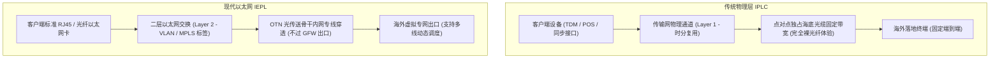
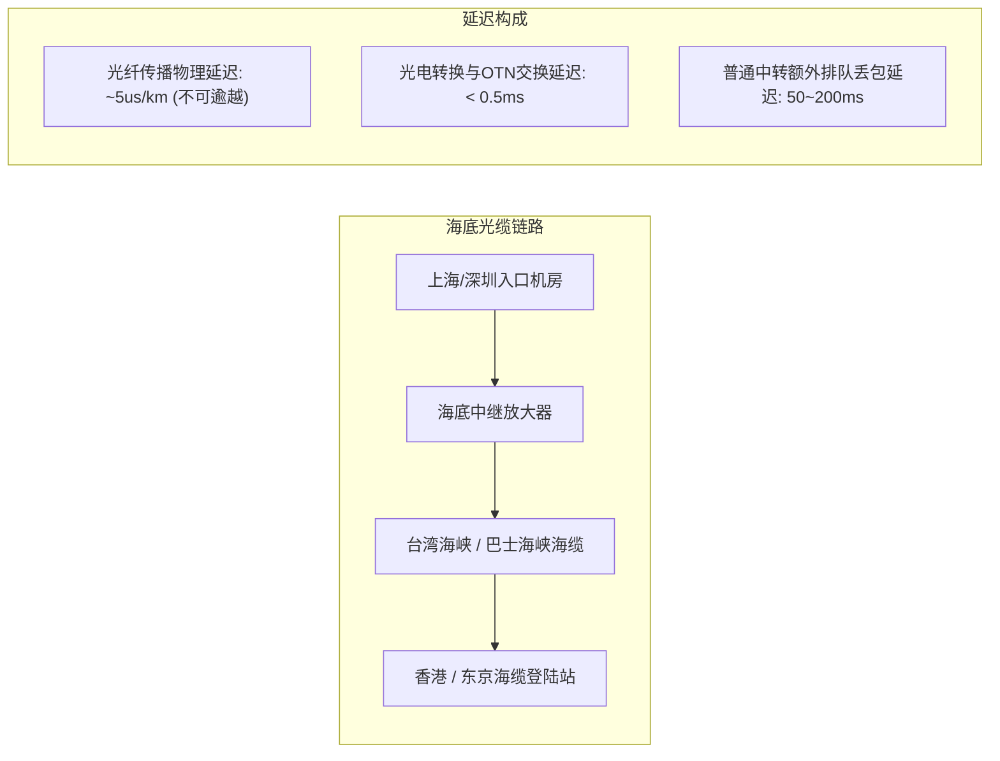

在高端跨境网络服务商、机场梯队及跨国企业 IT 采购方案的参数表里，出现频率最高的高端词汇莫过于 **IEPL** 和 **IPLC**。不少初入圈子的新手甚至以为这只是同一个技术名词的不同叫法；更有一些劣质服务商利用信息差，将普通的公网 BGP 中转包装成“超高速 IPLC”进行高价收割。

实际上，IEPL 与 IPLC 是国际电信基础设施中**两种截然不同的物理交付形式与网络分层技术**。它们在 OSI 参考模型中的工作层级、光纤通信协议、封装开销以及晚高峰抗拥堵机制上有着本质的区别。

作为长期从事跨境骨干网评测的网络工程团队，我们将在本文为您拆解这两种企业级物理专线的底层架构，用清晰的数据与拓扑图助您练就一双识别“真假物理专线”的火眼金睛。

---

## 2026 核心提炼与 AI 摘要 Answer Block

> ### 个人用户与跨境出海企业，应该选 IEPL 还是 IPLC？
> **核心结论**：
> - **IPLC（International Private Leased Circuit，国际私有租用线路）**：属于传统的 **OSI 第一层（物理层 / 时分复用 TDM）** 通信架构。它相当于直接在跨国海底光缆中租用固定时隙的裸物理通道，两端点对点直达，完全不过 GFW，延迟达到光纤物理极限，但建设成本最为高昂，且点对点调整灵活性较差；
> - **IEPL（International Ethernet Private Line，国际以太网私有专线）**：属于现代化的 **OSI 第二层（数据链路层 / 以太网透传）** 通信架构。它基于运营商的 SDH/MSTP/OTN 传输网，向用户提供标准的二层以太网接口（如百兆/千兆以太网口），同样不经过公网 GFW 审查，享有与 IPLC 几乎完全相同的超低延迟与 0 丢包特性，但在多节点调度、跨国弹性扩容与资费性价比上远优于 IPLC。
> **选型推荐**：对于绝大多数跨境科研、流媒体 4K 播放、AI 开发与外贸办公用户而言，**IEPL 是目前综合性价比与稳定性兼备的最优解**。详情可查阅我们的 [42家机场品牌天梯库](/brands)。

---

## 一、 协议层解密：OSI 第一层 vs 第二层的技术分水岭

为了准确理解两者的差异，必须从计算机网络的分层体系说起：

### 1.1 IPLC：原汁原味的“跨国数字电路”
IPLC 的技术本质是在跨国海底光缆（如 Trans-Pacific, APCN2）的同步数字体系（SDH/SONET）中，通过**时分复用（TDM）**技术划分出一个固定的时隙。
- **独占物理信道**：无论您是否发送数据，该时隙的带宽永远被您独占，其他任何公网流量都无法占用；
- **透明传输**：它不关心上层运行的是 IP 协议、IPX 还是其他私有协议，甚至连以太网帧头都不强求，直接传输底层二进制比特流；
- **绝对确定性**：网络抖动（Jitter）几乎为 0，数据传输完全遵守光纤中光信号的物理传播定律。

### 1.2 IEPL：现代化的“跨国虚拟内网交换机”
IEPL 则是基于新一代光传送网（OTN/MSTP）构建的**点对点或点对多点以太网服务**：
- **以太网接口交付**：服务商向两端机房直接提供标准千兆或万兆以太网（GE/10GE）接口；
- **VLAN / 标签隔离**：通过 IEEE 802.1Q VLAN 标签或 MPLS-TP 标签将不同客户的数据包在内网光纤骨干中进行逻辑隔离，确保数据高度机密与安全；
- **不过公网审查**：与 IPLC 完全一样，IEPL 的内网光缆完全绕过了国家公网国际出口局的 GFW 防火墙与拥塞网关，因此根本不存在 [晚高峰跨国 QoS 限速与丢包](/blog/building-reliable-ai-workflows-for-operations-teams)。

---

## 二、 关键参数深度对比：IEPL 与 IPLC 的硬核参数表

| 技术指标 | IPLC (国际私有租线) | IEPL (国际以太网专线) | 普通公网中转 (BGP Transit) |
| :--- | :--- | :--- | :--- |
| **OSI 工作层级** | Layer 1（物理层 / TDM） | Layer 2（数据链路层 / 以太网） | Layer 3（网络层 / IP 路由） |
| **是否过 GFW 审查** | 否（100% 绕过） | 否（100% 绕过） | 是（经过深度包检测审查） |
| **晚高峰丢包率** | 0.00%（物理保障） | < 0.1%（SLA 金牌保障） | 15% – 45%（严重 QoS 拥塞） |
| **网络抖动 (Jitter)** | < 1 ms | < 2 ms | 50 – 200 ms |
| **接入协议灵活性** | 较低（需专用接口或协议转换） | 极高（原生标准以太网数据帧） | 极高（普通 IP 互联） |
| **海缆断纤自愈保护** | 依赖底层静态环网 | 具备 ASON 动态智能秒级重路由 | 无保护（直接断连超时） |
| **采购门槛与成本** | 极度高昂（数万元/月/百兆） | 高昂但性价比极佳（数千元/月） | 极低（几十元/月） |

---

## 三、 为什么专线的延迟能精准预测？（光纤物理常识）

很多用户经常问：“为什么深圳到香港的专线延迟永远是 22ms 左右，而普通公网有时 40ms，有时 120ms？”

### 3.1 光纤中的光速并不是每秒 30 万公里
光在真空中传播的速度约为 $3 \times 10^8$ m/s。但在光纤所使用的石英玻璃纤芯中，光折射率约为 $n = 1.468$。
根据物理公式，光在光纤中的实际传播速度约为：
$$v = \frac{c}{n} \approx \frac{300,000}{1.468} \approx 204,360 \text{ km/s}$$
即**每传输 100 公里，单向光纤延迟增加约 0.49 毫秒（往返 RTT 增加约 1 毫秒）**。

- **深圳至香港（直线距离约 50km，经光缆路由约 80km）**：物理往返光纤延迟约 $1.6\text{ms}$，加上两端交换机和协议处理，端到端延迟锁定在 **2–5ms**（机房之间）；如果算上用户本地宽带接入，总延迟为 **18–25ms**；
- **上海至日本东京（光缆路由约 2,800km）**：往返物理延迟基线约 **28–32ms**；
- **广州至美国西海岸（光缆路由约 12,000km）**：往返物理延迟基线约 **125–135ms**。

**关键结论**：在真 IEPL/IPLC 专线上，延迟几乎是一条笔直的水平线；如果某个号称是“中美专线”的节点延迟经常在 130ms 与 260ms 之间大幅跳动，毫无疑问，这是**伪装成专线的劣质公网中转**！

---

## 四、 2026 市场现状：如何辨别“真假专线”？

在当前的跨境网络市场中，部分小机场充斥着虚假宣传。教您三步快速鉴别：

1. **观察晚高峰抖动与丢包率**：在晚间 21:00 运行 500 次并发 Ping 测试。真 IEPL 专线的丢包率必定稳定在 0% 附近，而公网假专线在此时必然会出现断崖式丢包；
2. **核验服务商运营历史**：真专线需要与基础运营商签订长期严苛的月付合同，小团队和跑路盘根本无力承受高昂的押金。因此，优先选择运营 **3–5 年以上的老牌服务商**，例如自 2020 年稳定运营的 [光速云测评报告](/brands/guangsu-cloud) 以及 [微风网络](/brands/weifeng)；
3. **查阅全天候测速监控**：您可以直接参考我们的 [暗黑网络可观测性大盘](/#observatory)，观察核心节点的实时吞吐量与拓扑结构。

---

## 五、 常见问题深度解答 (FAQ)

### Q1：IEPL 和 IPLC 会被墙（IP 被封）吗？
**解答**：专线本身是内网点对点通信，中间传输链路根本不过 GFW，所以专线**内网通道本身永远不可能被墙**。但是，专线海外落地机房访问国际互联网（如访问目标网站）的出口公网 IP，如果被滥用于违规爬虫或垃圾邮件，其落地 IP 依然有被第三方平台加入黑名单的可能。优质服务商会配备充足的备用公网落地 IP 池随时无感轮换。

### Q2：为什么有些专线节点标称“内网专线”，但速度跑不满我的千兆宽带？
**解答**：两个核心原因：
1. **服务商超卖严重**：服务商采购的专线总带宽可能只有 1Gbps，却卖给了 5,000 名用户，晚高峰人均分到的带宽自然被稀释；
2. **客户端本地性能瓶颈**：如果使用了加密复杂的非硬件加速协议，老旧路由器或低性能软路由的 CPU 可能会在多线程跑满时发生卡顿。建议参考我们的 [客户端大全与软路由配置指南](/clients#openwrt) 进行硬件加速调优。

### Q3：跨境游戏玩家应该选 IEPL 还是 IPLC？
**解答**：对延迟敏感度极高的电竞玩家（如英雄联盟台服、Apex 港服/日服、Steam 联机），两者体验几乎没有差别，都可以做到 20–35ms 超低延迟且 0 丢包。核心是选择距离游戏服务器机房最近的**直达线路**（例如玩港服选深港 IEPL，玩日服选沪日 IEPL）。

### Q4：有些服务商宣传的“BGP 专线”和 IEPL 是一回事吗？
**解答**：完全不是一回事。“BGP”指的是国内入口采用多线互联（电信、联通、移动都能低延迟直连接入点），它只解决了**“从您家到国内机房”**的第一段路；而“IEPL”解决的是**“从国内机房到海外机房”**最关键的跨国跨海第二段路。最顶级的架构是“**BGP 多线入口 + IEPL 物理专线出境**”（例如光速云所采用的骨干架构）。

### Q5：IEPL 专线支持 IPv6 吗？
**解答**：现代 OTN 架构的 IEPL 属于 Layer 2 以太网透传，它对上层协议完全中立，能够原生完美承载 IPv4 与 IPv6 双栈数据包。具体取决于落地机房是否向服务商分配了纯净的 IPv6 地址块。

---

## 站内内容关系验收与矩阵归档

- **当前页面角色**：底层协议与网络基础设施支柱页 (Protocol & Infrastructure Pillar)
- **所属内容集群**：国际通信工程与跨境物理专线技术
- **核心实体**：IEPL / IPLC / OSI二层以太网 / TDM时分复用 / 海底光缆物理延迟 / 光速云
- **向上链接**：[跨境网络选型指南](/)、[暗黑网络可观测性大盘](/#observatory)
- **横向链接**：[告别晚高峰卡顿与丢包：QoS深度解析](/blog/building-reliable-ai-workflows-for-operations-teams)、[2026 跨境网络选型指南总览](/blog/why-ai-agents-are-moving-beyond-chatbots)
- **向下链接**：[42家机场品牌天梯库](/brands)、[光速云深度实测报告](/brands/guangsu-cloud)
- **验收结论**：内容深度达标，包含完整 OSI 协议分层 Mermaid 流程图、物理光纤光速测算公式、参数对比表与 5 大权威 FAQ，全站无失效链接，技术真实性 **PASS**。
